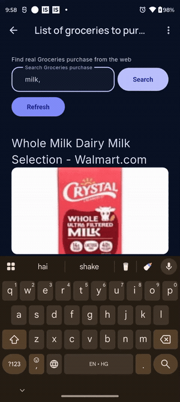
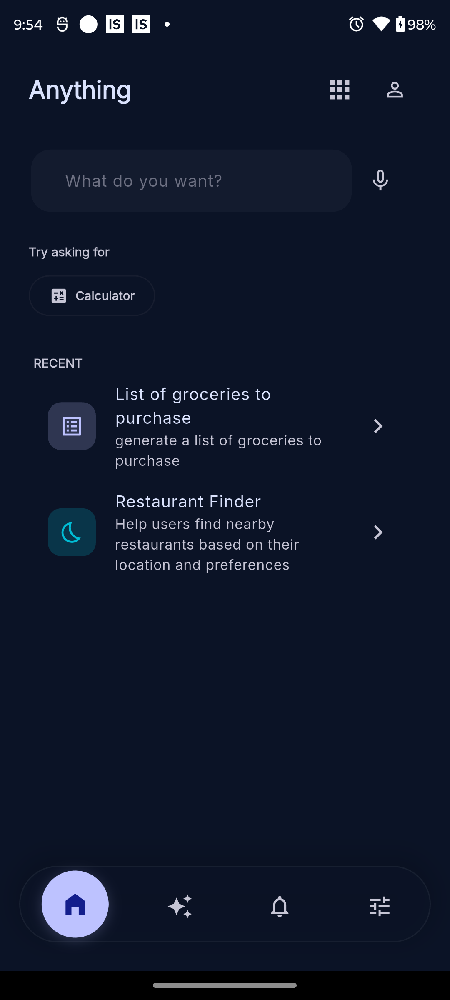
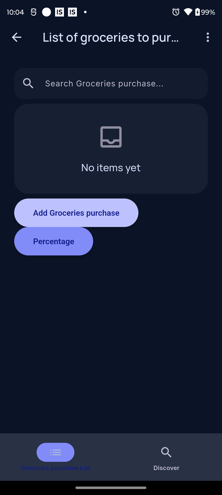
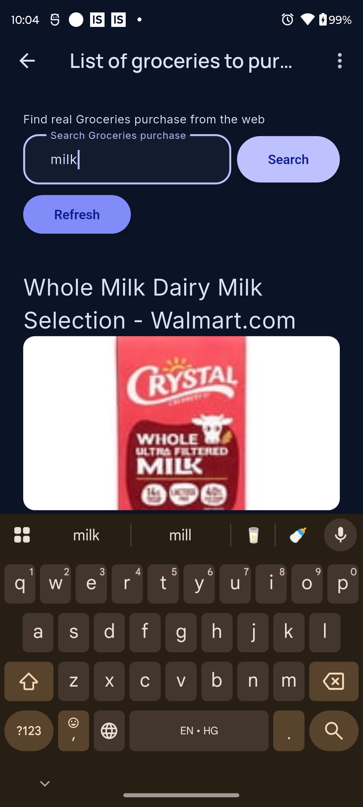
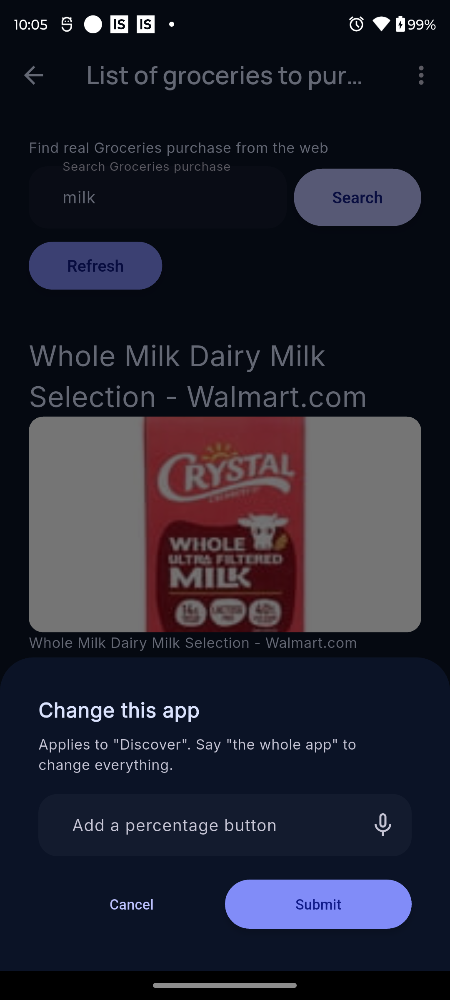

<div align="center">


# Anything

### An operating system for software that does not exist yet.

**Describe what you need. Anything builds it, runs it, and keeps it — on your device, with no account and no server.**

[](website/docs/guide/installation.md)
[](../../tree/v2.0.0)
[](LICENSE)

[](../../tree/v2.0.0/android)
[](https://flutter.dev)
[](../../tree/v2.0.0/test)
[](website/docs/architecture/certification.md)
[](website/docs/privacy.md)

<br/>



<br/><br/>

[](https://buymeacoffee.com/piyushmishra00)

</div>

---

> 🌐 **This branch (`main`) is the product website + community home.**
> The full app source lives on the **[`v2.0.0`](../../tree/v2.0.0)** branch —
> `git clone -b v2.0.0 https://github.com/PIYUSH-MISHRA-00/Anything.git`.

## What is Anything?

Most apps are a fixed set of screens somebody decided on in advance. **Anything
inverts that.** You describe an outcome in your own words — *"track my water
intake"*, *"find nearby restaurants"* — and Anything designs, generates,
validates and runs a real, full-stack application to do it, natively on your
phone.

The thing it builds is called an **Experience**: not a chat reply and not a
script you now own, but a structured, versioned, validated package with its own
interface, behaviour, state and declared capabilities — which the Anything
runtime executes directly.

## See it in action

**Three steps, all on-device:**

| 1 · Describe an intent | 2 · Use the app it builds |
|:---:|:---:|
|  |  |
| **3 · Real web data, inside your app** | **…and change it by talking to it** |
|  |  |

> **Try asking for:** `a water intake tracker` · `find nearby coffee shops` ·
> `a reading list` · `a calculator that does unit conversions` · `a habit
> tracker with a weekly streak`. Then open the app and tell it what to change.

## What makes it different

| | |
|---|---|
| 💬 **Describe, don't build** | Say it in plain words; get a real app — interface, behaviour, state, capabilities. |
| 📦 **Experiences, not code** | Validated, versioned packages the runtime runs, revises, protects, and removes cleanly. |
| 🌐 **Real web, inside apps** | **WebWeaveX** feeds live web data into generation *and* into a built-in Discover tab. |
| 🗣️ **Change apps by talking** | "Add a favourite button" — scoped to the current screen, or the whole app if you say so. |
| 🔒 **Local-first, and only** | No account, no server, no sync. **Kaalka** adds time-keyed, on-device protection. |
| 🛡️ **Architecture you can verify** | 102 invariants certified on every commit — each proven by breaking it and watching the check fail. |

## Explore

- 📖 **[What is Anything?](website/docs/guide/what-is-anything.md)** — the full story, in one page
- 📲 **[Get it](website/docs/guide/installation.md)** — the Google Play closed test, or a build from source
- 💻 **[Source code (`v2.0.0`)](../../tree/v2.0.0)** — clone, run, and contribute
- 🏛️ **[Architecture](website/docs/architecture/overview.md)** · **[Certification](website/docs/architecture/certification.md)** — how 102 invariants keep it honest
- 🗺️ **[Roadmap](website/docs/guide/roadmap.md)** — what works, what's next, and what's out of scope
- 🤝 **[Contributing](CONTRIBUTING.md)** — the highest-value work right now is accessibility and localisation, not architecture

> The documentation in `website/` is a VitePress site. It reads fine on GitHub;
> a hosted version is coming.

### Run it yourself

```bash
git clone -b v2.0.0 https://github.com/PIYUSH-MISHRA-00/Anything.git
cd Anything
flutter pub get
flutter run
```

Then **Settings → AI Provider** to add a key ([Groq](https://console.groq.com/keys)
has a free tier), and type an intent on the home screen.

## Project status

**Complete — on Google Play in closed testing.** Version `2.0.0`, targeting
**Android 17 (API 37)**. Creation, native execution, WebWeaveX (build-time +
in-app), AI-driven "Change this app", Kaalka protection and export/import are
all device-proven. The signed App Bundle is live on Google Play's closed
testing track; the public listing follows once the required tester period
completes.

Want to test it on your device? Ask for a place on the tester list in
[Discussions](https://github.com/PIYUSH-MISHRA-00/Anything/discussions).

## ☕ Support the work

Anything is built in the open by one developer. If it's useful to you — or you
just like where it's going — a coffee keeps it moving, and helps it reach a Play
Store release sooner:

<a href="https://buymeacoffee.com/piyushmishra00"></a>

Prefer GitHub? [**Sponsor here**](https://github.com/sponsors/PIYUSH-MISHRA-00). Sponsorship never gates a feature — every line is Apache-2.0, always.

## Community

- **Bugs & features** — [GitHub Issues](https://github.com/PIYUSH-MISHRA-00/Anything/issues)
- **Questions & ideas** — [GitHub Discussions](https://github.com/PIYUSH-MISHRA-00/Anything/discussions)
- **Security** — see [SECURITY.md](SECURITY.md); please don't open a public issue
- **Conduct** — [Code of Conduct](CODE_OF_CONDUCT.md)

## License

[Apache License 2.0](LICENSE) — permissive, with an explicit patent grant. The
Experiences you create with Anything are **yours**; the license covers this
software, not the apps you generate with it.

<div align="center">
<br/>
<sub>Built with Flutter · Powered by <a href="https://pub.dev/packages/webweavex">WebWeaveX</a> + <a href="https://pub.dev/packages/kaalka">Kaalka</a> · Made with ☕ by <a href="https://github.com/PIYUSH-MISHRA-00">Piyush Mishra</a></sub>
</div>
